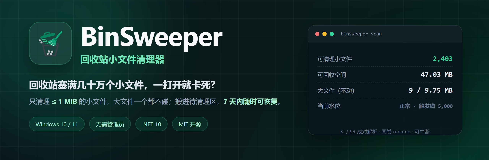
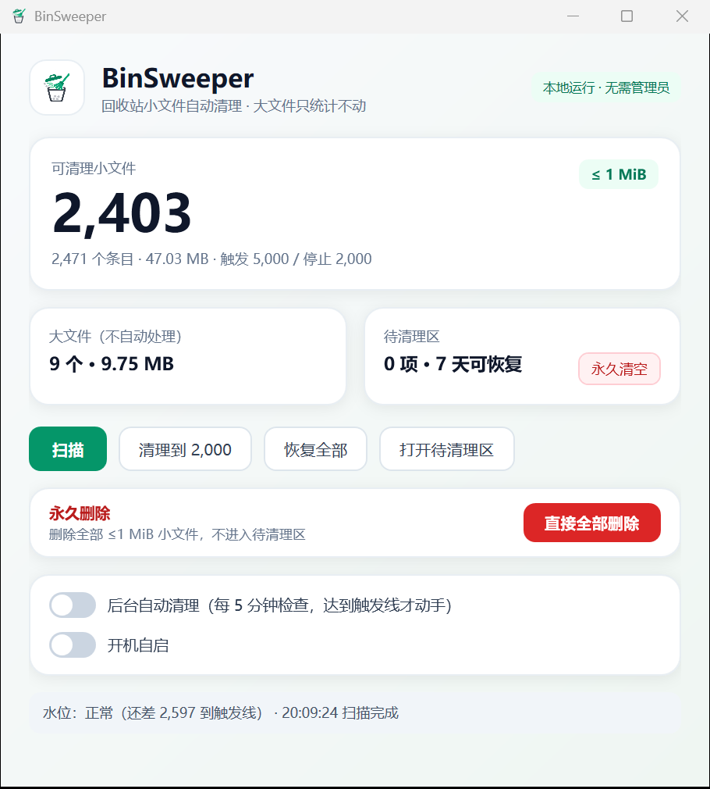

<div align="center">
  

  <h1>BinSweeper</h1>

  <p><b>A Recycle Bin cleaner that only touches small files. Your large files stay untouched.</b></p>

  <p>
    <a href="https://github.com/yuehua-meng/binsweeper/actions/workflows/build.yml"></a>
    <a href="https://github.com/yuehua-meng/binsweeper/releases/latest"></a>
    <a href="https://github.com/yuehua-meng/binsweeper/releases"></a>
    <a href="LICENSE"></a>
    <a href="https://github.com/yuehua-meng/binsweeper/stargazers"></a>
  </p>

  <p>
    
    
    
    
  </p>

  <p>
    <a href="README.md">简体中文</a> · <b>English</b> ·
    <a href="https://github.com/yuehua-meng/binsweeper/releases/latest">Download</a> ·
    <a href="https://github.com/yuehua-meng/binsweeper/issues">Issues</a>
  </p>
</div>

---

When a Recycle Bin holds hundreds of thousands of build artifacts, logs, and temp files, opening it takes forever and even "Empty Recycle Bin" can freeze Explorer.

BinSweeper does one thing: **move small files (≤ 1 MiB) out of the Recycle Bin safely**, bringing the entry count back to a usable range. Large files are never touched, mixed directories are skipped entirely, and everything moved can be restored.

<p align="center">
  
</p>

## Why not just "Empty Recycle Bin"?

| Approach | Problem |
| --- | --- |
| Manually sort by size and click through | Tens of thousands of entries; not practical |
| Empty the whole Recycle Bin | Large files and files you wanted to keep are gone for good |
| Generic "cleaner" suites | Full-disk scans, admin rights, opaque rules, bundleware |
| **BinSweeper** | Size-based only; staging area; large files untouched; restorable; offline |

## Highlights

- **Small files only** — default `≤ 1 MiB`, configurable via `--small-limit`.
- **Large files are never touched** — they are counted and displayed, nothing else.
- **Mixed directories are skipped whole** — if a directory contains any large file, the entire directory is left alone.
- **Two-stage safety model** — items are `rename`d into a local staging area first; physical deletion only happens when you ask for it.
- **Same-volume rename** — moving 100k files does not copy data, it only updates directory entries.
- **Rollback on failure** — `$I` / `$R` pairs are moved together; a failed move is reverted.
- **Offline and no admin** — reads only your own Recycle Bin, no upload, no telemetry.
- **Tray app with thresholds** — checks every 5 minutes; starts at 5,000 eligible small files and stops at 2,000.
- **Scriptable CLI** — `scan`, `stage`, `purge`, `staging`, `restore`; dry-run by default.

## Quick start

### Download

1. Open [Releases](https://github.com/yuehua-meng/binsweeper/releases/latest).
2. Download `BinSweeper.exe` — a self-contained single file, no .NET installation required.
3. Run it. The first scan reports eligible small files, large files, and the staging area.

> The binary is not code-signed, so SmartScreen may show "Unknown publisher". Choose "More info → Run anyway", or build from source.

### Build from source

Requires [.NET 10 SDK](https://dotnet.microsoft.com/download) on Windows 10/11.

```bash
git clone https://github.com/yuehua-meng/binsweeper.git
cd binsweeper

dotnet build -c Release
dotnet test  -c Release
dotnet run --project src/BinSweeper.App

# single-file publish
dotnet publish src/BinSweeper.App -c Release -r win-x64 --self-contained true -p:PublishSingleFile=true
```

## CLI

```bash
binsweeper scan
binsweeper scan --scope "C:\dev\myapp" --small-limit 64KB --top 20

binsweeper stage --target 2000            # dry run
binsweeper stage --target 2000 --apply    # move to staging

binsweeper staging
binsweeper restore all

binsweeper purge --apply                  # permanent, cannot be undone
```

## How it works

1. Locate `$Recycle.Bin\<SID>` on every fixed volume for the current user.
2. Parse the `$I` metadata (original path, deletion time, size) and pair it with the `$R` content.
3. Classify each entry as **eligible small file**, **large file**, **mixed directory**, or **unknown**.
4. Only eligible entries are moved, using a same-volume `rename`, into `%LOCALAPPDATA%\BinSweeper\staging`.
5. `restore` moves them back into the Recycle Bin; `purge` is the only operation that permanently deletes data.

### Never touched

- Files above the small-file threshold
- Directories containing any large file (the whole directory is skipped)
- Broken metadata, missing `$R`, or partially enumerated "unknown" entries
- Other users' Recycle Bins, removable/network drives
- Entries whose original path is outside `--scope`

### Known limitations

- Windows 10/11, fixed volumes, current user only.
- The staging area keeps items for 7 days, but automatic expiry-based deletion is still on the roadmap; today you clear it manually.
- No code signing yet.
- A directory with more than 50,000 entries is treated as "unknown" and skipped.

## FAQ

<details>
<summary><b>Can it delete my important files?</b></summary>

It never automatically deletes large files, and small files are only moved into a staging area. Permanent deletion happens only when you click "Delete all" or "Empty staging area".

</details>

<details>
<summary><b>Why the 1 MiB threshold?</b></summary>

Recycle Bin lag is usually caused by entry count, not total size. Removing small files reduces the count fastest while minimizing the risk of deleting something important. Lower it with `--small-limit 64KB` if you want to be more conservative.

</details>

<details>
<summary><b>Where is the staging area?</b></summary>

`%LOCALAPPDATA%\BinSweeper\staging`. Use "Restore all" or `binsweeper restore all` to put items back into the Recycle Bin, where Explorer can still restore them to their original location.

</details>

<details>
<summary><b>Does it need admin rights or upload data?</b></summary>

No admin rights. It only reads the current user's own Recycle Bin, and it is fully offline.

</details>

## Roadmap

- [x] Read-only scan, `$I/$R` parsing, classification
- [x] Stage A: same-volume rename into staging, restore
- [x] WPF tray UI, automatic thresholds, start with Windows
- [x] CLI
- [ ] Stage B: idle/nightly physical deletion with IO throttling
- [ ] Automatic expiry and capacity-based eviction
- [ ] Large-file view and manual cleanup guidance
- [ ] Crash reconciliation and operation log

## Contributing

Issues and pull requests are welcome. Please include your Windows version, approximate Recycle Bin entry count, and reproduction steps. For changes to deletion logic, describe the failure/rollback path. Run `dotnet test` before submitting.

## License

[MIT](LICENSE) © 2026 yuehua-meng

If BinSweeper made your Recycle Bin usable again, a star is the best way to say thanks.
