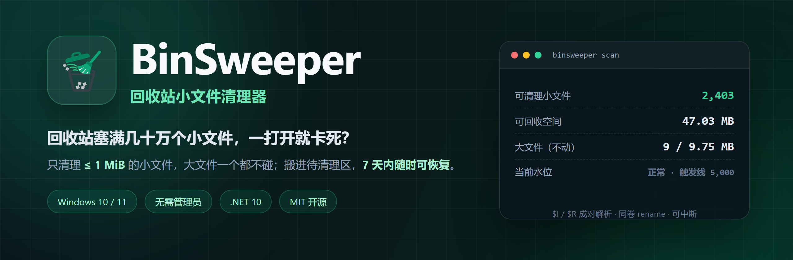
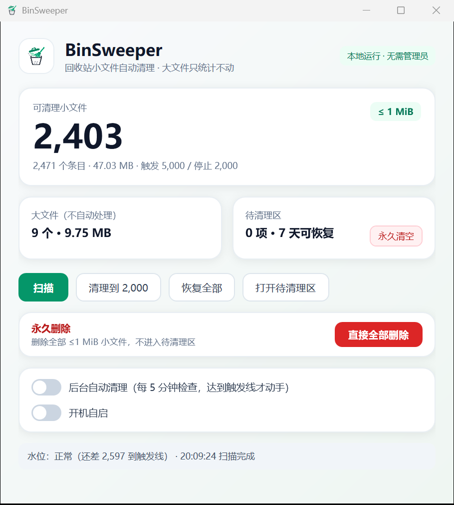

<div align="center">
  

  <h1>BinSweeper</h1>

  <p><b>回收站小文件清理器：只碰小文件，大文件一个都不动。</b></p>

  <p>
    <a href="https://github.com/yuehua-meng/binsweeper/actions/workflows/build.yml"></a>
    <a href="https://github.com/yuehua-meng/binsweeper/releases/latest"></a>
    <a href="https://github.com/yuehua-meng/binsweeper/releases"></a>
    <a href="LICENSE"></a>
    <a href="https://github.com/yuehua-meng/binsweeper/stargazers"></a>
    <a href="https://gitee.com/kongbaiblank/binsweeper"></a>
  </p>

  <p>
    
    
    
    
  </p>

  <p>
    <b>简体中文</b> · <a href="README.en.md">English</a> ·
    <a href="https://yuehua-meng.github.io/binsweeper/">官网</a> ·
    <a href="https://github.com/yuehua-meng/binsweeper/releases/latest">下载最新版</a> ·
    <a href="https://gitee.com/kongbaiblank/binsweeper/releases">Gitee 发行版</a> ·
    <a href="https://github.com/yuehua-meng/binsweeper/issues">反馈问题</a>
  </p>
</div>

---

回收站里堆了几十万个构建产物、日志、缓存和临时文件之后，打开回收站要等半天，右键「清空」能把资源管理器直接卡死，连任务栏都会跟着转圈。

BinSweeper 只做一件事：**把回收站里 ≤ 1 MiB 的小文件安全地移出回收站**，让条目数量回到可用范围。大文件保持原样，混合目录直接跳过，你随时可以把移走的条目原样放回。

<p align="center">
  
</p>

## 为什么不用「全选删除」或「一键清空」

| 做法 | 结果 |
| --- | --- |
| 在回收站里按大小排序、手动挑小文件 | 几万条起，鼠标点不过来 |
| 直接「清空回收站」 | 大文件、还想留的文件一起没了，无法恢复 |
| 通用清理软件 | 扫描全盘、要管理员、规则不透明，还可能捆绑 |
| 改注册表 / 命令行 `rd /s` | 容易把 `$I`、`$R` 配对关系搞坏，回收站出现幽灵条目 |
| **BinSweeper** | 只按大小分流；先移入待清理区；大文件不动；可恢复；本地运行 |

## 核心特性

- **只清小文件**：默认只处理 `≤ 1 MiB` 的条目，界值可调（`--small-limit 64KB` 更保守）。
- **大文件绝对不动**：大于界值的文件只统计数量和占用，永远不会被自动处理。
- **混合目录整目录跳过**：一个目录里只要包含大文件，整个目录都不碰，避免误伤你留着手动处理的内容。
- **两阶段安全模型**：先 `rename` 进「待清理区」，确认 7 天内可一键放回；真正的物理删除永远由你手动触发。
- **同卷 rename，不复制数据**：移动几万个文件也只需要更新目录项，速度和空间占用都可控。
- **失败可回滚**：`$I` / `$R` 成对搬运，中途失败会把内容搬回原处，不留下孤立条目。
- **本地运行，无上传**：不上传文件名、不联网、不需要管理员权限，只读取当前用户自己的回收站。
- **托盘常驻 + 自动水位**：后台每 5 分钟检查，达到 5,000 才动手，降到 2,000 停止；也可以完全手动。
- **CLI 可脚本化**：`scan` / `stage` / `purge` / `staging` / `restore`，默认只预演，加 `--apply` 才真正执行。
- **多卷支持**：自动遍历所有固定磁盘上的当前用户回收站目录。

## 快速开始

### 方式一：下载即用（推荐）

1. 打开 [Releases](https://github.com/yuehua-meng/binsweeper/releases/latest) 或 [Gitee 发行版](https://gitee.com/kongbaiblank/binsweeper/releases)。
2. 下载 `BinSweeper.exe`。单文件、自带运行时，不需要安装 .NET。
3. 双击运行。首次启动会自动扫描，结果分为「可清理小文件 / 大文件 / 待清理区」。

> 程序没有代码签名，Windows SmartScreen 可能提示「未知发布者」。点「更多信息 → 仍要运行」即可。介意的话可以按下面的方式从源码构建。

### 方式二：从源码构建

需要 [.NET 10 SDK](https://dotnet.microsoft.com/download) 和 Windows 10/11。

```bash
git clone https://github.com/yuehua-meng/binsweeper.git
cd binsweeper

dotnet build -c Release
dotnet test  -c Release

# 启动图形界面
dotnet run --project src/BinSweeper.App

# 或者发布成单文件 exe
dotnet publish src/BinSweeper.App -c Release -r win-x64 --self-contained true -p:PublishSingleFile=true
```

## 命令行用法

```bash
# 只读扫描：统计可清理小文件、大文件、混合目录、未知条目
binsweeper scan
binsweeper scan --scope "C:\dev\myapp" --small-limit 64KB --top 20

# 预演：算出会搬走多少条目，不改动任何文件
binsweeper stage --target 2000

# 真正搬运：同卷 rename 到待清理区
binsweeper stage --target 2000 --apply

# 查看待清理区、按 id 或全部放回回收站
binsweeper staging
binsweeper restore all

# 跳过待清理区，永久删除可清理小文件（不可恢复）
binsweeper purge --apply
```

| 命令 | 作用 | 是否改动文件 |
| --- | --- | --- |
| `scan` | 只读统计与水位判断 | 否 |
| `stage` | 把可清理条目移入待清理区 | 仅在 `--apply` 时 |
| `staging` | 列出待清理区条目与剩余保留时间 | 否 |
| `restore <id\|all>` | 把待清理区条目放回回收站 | 是（放回） |
| `purge` | 永久删除可清理小文件 | 仅在 `--apply` 时 |

`--scope` 可重复指定，只处理原路径位于这些目录下的条目；缺省为全部回收站。

## 策略参数

| 项目 | 默认值 | 说明 |
| --- | --- | --- |
| 小文件界值 | `1 MiB` | 超过即视为大文件，只统计、不处理 |
| 触发线 | `5,000` | 可清理小文件数达到该值才开始搬运 |
| 停止线 | `2,000` | 搬运到该值以下停止 |
| 紧急线 | `20,000` | 达到后忽略间隔，直接降到停止线 |
| 最小间隔 | `15 分钟` | 两次自动搬运之间的冷却 |
| 待清理区保留 | `7 天` | 期间可随时 `restore` 放回 |
| 目录枚举上限 | `50,000` 项 | 超过按「未知」处理，不自动搬 |

运行时会显示当前水位：`正常 / 已达触发线 / 紧急`。自动清理默认开启，但只有真正达到触发线才会动手；可以在界面里随时关闭。

## 安全模型

```text
                   ┌───────────────────────────────┐
                   │      BinSweeper.App (WPF)     │
                   │  托盘 · 扫描 · 清理 · 恢复    │
                   └───────────────┬───────────────┘
                                   │
                   ┌───────────────┴───────────────┐
                   │        BinSweeper.Core        │
                   │  RecycleBin · Scan · Staging  │
                   │  Policy     · Delete          │
                   └───────────────┬───────────────┘
                                   │
        ┌──────────────────────────┼──────────────────────────┐
        │                          │                          │
  $Recycle.Bin              待清理区 staging              CLI / 脚本
  $I 元数据 + $R 内容        %LOCALAPPDATA%\BinSweeper      binsweeper.exe
```

一次清理只做三件事：

1. **扫描**：定位每个卷的 `$Recycle.Bin\<SID>`，解析 `$I` 元数据（原路径、删除时间、大小），与 `$R` 内容配对；目录条目递归统计内部文件。
2. **分级**：`可清理小文件` / `大文件` / `混合目录` / `未知`。只有第一类会进入候选。
3. **搬运**：把成对的 `$I`、`$R` 用同卷 `rename` 移到 `%LOCALAPPDATA%\BinSweeper\staging\<卷>\<时间戳-id>\`，条目从回收站消失，内容原样保留。`restore` 做反向操作，`purge` 才会真正删除。

### 永远不会碰的东西

- 大于小文件界值的文件
- 含大文件的混合目录（整目录跳过）
- 元数据损坏、`$R` 缺失、无法完整枚举的「未知」条目
- 其他用户、其他卷类型（U盘/网络盘）的回收站
- 指定范围之外的原路径

### 已知限制

- 目前只支持 Windows 10/11 的**固定磁盘**和**当前用户**。
- 待清理区默认保留 7 天，但「到期自动物理删除」仍在 Roadmap；当前到期后需要你手动点「永久清空」。
- 程序未做代码签名，首次运行可能触发 SmartScreen 提示。
- 目录内部枚举超过 50,000 项会按「未知」跳过，这是为了保护扫描性能。

## 常见问题

<details>
<summary><b>会不会把我重要的文件删掉？</b></summary>

不会自动删除任何大文件；小文件也只是先移入待清理区，不会立刻物理删除。真正的删除动作只有两个：你手动点「直接全部删除」，或你手动点「永久清空待清理区」。

</details>

<details>
<summary><b>为什么只处理 ≤ 1 MiB 的小文件？</b></summary>

回收站卡顿的根因通常是「条目数量」而不是「总体积」：几十万个小文件会让资源管理器逐条读取元数据。清理小文件能最快把条目数降下来，同时把误删大文件的风险降到最低。界值可以通过 `--small-limit` 调低到 64 KiB。

</details>

<details>
<summary><b>待清理区的文件在哪里？还能找回来吗？</b></summary>

默认在 `%LOCALAPPDATA%\BinSweeper\staging`。界面点「恢复全部」或命令行 `binsweeper restore all`，会把条目原样放回回收站，之后仍可在资源管理器里「还原到原位置」。你也可以直接进这个目录手动查看。

</details>

<details>
<summary><b>需要管理员权限吗？会不会上传数据？</b></summary>

不需要管理员。程序只读取当前用户自己的 `$Recycle.Bin\<SID>`，且完全离线运行，不上传任何文件或文件名。

</details>

<details>
<summary><b>支持 Windows 7 吗？</b></summary>

不支持。项目基于 .NET 10 和 WPF，最低要求 Windows 10 1607 及以上。

</details>

## Roadmap

- [x] 只读扫描、`$I/$R` 配对解析、小文件/大文件/混合目录分级
- [x] Stage A：同卷 `rename` 到待清理区，支持整体恢复
- [x] WPF 托盘界面、自动水位、开机自启
- [x] CLI：`scan` / `stage` / `purge` / `staging` / `restore`
- [ ] Stage B：空闲/夜间自动物理删除，PDH IO 闸门，可中断递归
- [ ] 到期自动清理与容量上限淘汰
- [ ] 大文件视图与手动清理引导
- [ ] 崩溃对账与操作日志
- [ ] 更多单元测试与边界用例

有想优先做的功能，欢迎在 [Issues](https://github.com/yuehua-meng/binsweeper/issues) 里提。

## 参与贡献

欢迎提交 Issue 和 Pull Request。提交前请尽量：

1. 先搜索是否已有相同 Issue；
2. 附上系统版本、回收站大致条目数、复现步骤；
3. 涉及删除逻辑的改动，请在 PR 中说明失败回滚路径；
4. 本地跑一遍 `dotnet test`。

## Star 趋势

<a href="https://star-history.com/#yuehua-meng/binsweeper&Date">
  
</a>

如果 BinSweeper 帮你把回收站从「卡死」变回「能用」，点一个 Star 就是最好的支持。

## 许可证

[MIT](LICENSE) © 2026 yuehua-meng

---

## English

**BinSweeper** is a Windows 10/11 Recycle Bin cleaner that only removes files **≤ 1 MiB**. Large files are never touched, mixed directories are skipped as a whole, and every removed item is first moved to a local staging area where it can be restored.

- No admin rights, fully offline, no telemetry.
- Same-volume `rename` instead of copying, so moving 100k small files stays fast.
- WPF tray app + scriptable CLI (`scan`, `stage`, `purge`, `staging`, `restore`).
- MIT licensed.

Read the full [English README](README.en.md).
